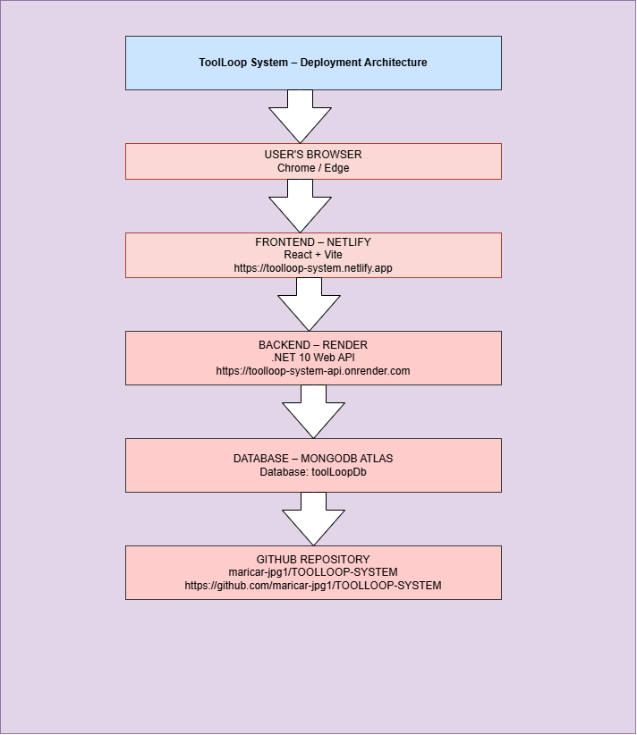
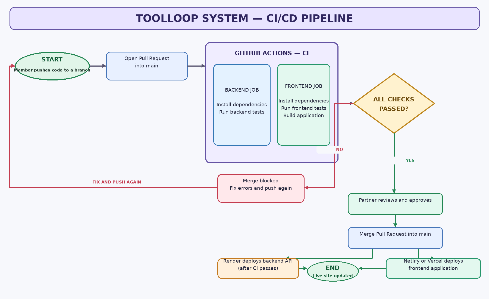

# Project Name

ToolLoop is a web-based equipment borrowing and management system that helps users view available equipment and manage equipment borrowing records.

## Live Links

- **Frontend:** https://tooloop-system.netlify.app/
- **Backend health check:** https://toolloop-system.onrender.com/api/health

## Team

| Member | Role |
|---|---|
| Ailyn Albesa | Frontend |
| Maricar Ofenia | Backend |

## Tech Stack

| Part | Technology | Hosted on |
|---|---|---|
| Frontend | React and Vite | Netlify |
| Backend | ASP.NET Core Web API (.NET 10) | Render |
| Database | MongoDB | MongoDB Atlas |
| Version Control | Git and GitHub | GitHub |
| CI/CD | GitHub Actions | GitHub Actions |

## Run It on Your Laptop

### Prerequisites

- Node.js
- .NET 10 SDK
- Git
- MongoDB Atlas account

### 1. Clone the repository

```bash
git clone https://github.com/maricar-jpg1/TOOLLOOP-SYSTEM.git
cd TOOLLOOP-SYSTEM
```

### 2. Run the backend

Open a terminal in the project root:

```bash
dotnet restore backend/ToolLoop.Api/ToolLoop.Api.csproj
dotnet run --project backend/ToolLoop.Api/ToolLoop.Api.csproj
```

### 3. Run the frontend

Open another terminal in the project root:

```bash
cd frontend
npm install
npm run dev
```

Open the local URL displayed in the frontend terminal.

## Environment Variables

Configure these variables locally and in the appropriate hosting dashboards. The example values below are placeholders only.

| Name | What it is for | Example value |
|---|---|---|
| VITE_API_URL | Frontend address of the backend API | http://localhost:5000 |
| MONGODB_URI | Backend connection to MongoDB Atlas | YOUR_MONGODB_CONNECTION_STRING |
| CLIENT_URL | Allowed frontend origin for backend CORS | https://example.netlify.app |

**Security:** Never commit real passwords, database connection strings, or API keys to GitHub. Keep secrets in local environment files or hosting environment settings. Use fake values in `.env.example`.

## Running the Tests

### Backend Tests

Run from the project root:

```bash
dotnet test backend/ToolLoop.Api.Tests/ToolLoop.Api.Tests.csproj
```

Expected: 5 backend tests.

### Frontend Tests

Run from the frontend folder:

```bash
npm run test:run
```

Expected: 3 frontend tests.

## How CI/CD Works

When a team member pushes code to a branch or opens a pull request targeting `main`, GitHub Actions runs the backend and frontend jobs. The backend job restores its dependencies and runs the backend tests, while the frontend job installs dependencies, runs frontend tests, and builds the application. After the required checks pass and the pull request is approved and merged, Render deploys the backend after CI checks pass, while Netlify deploys the frontend from `main`.

**GitHub Actions:** https://github.com/maricar-jpg1/TOOLLOOP-SYSTEM/actions

## Diagrams

### Deployment Architecture



### CI/CD Pipeline

